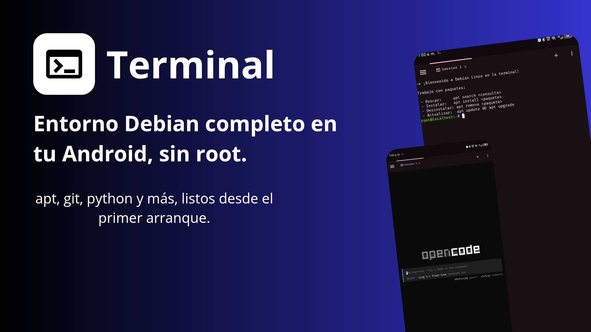
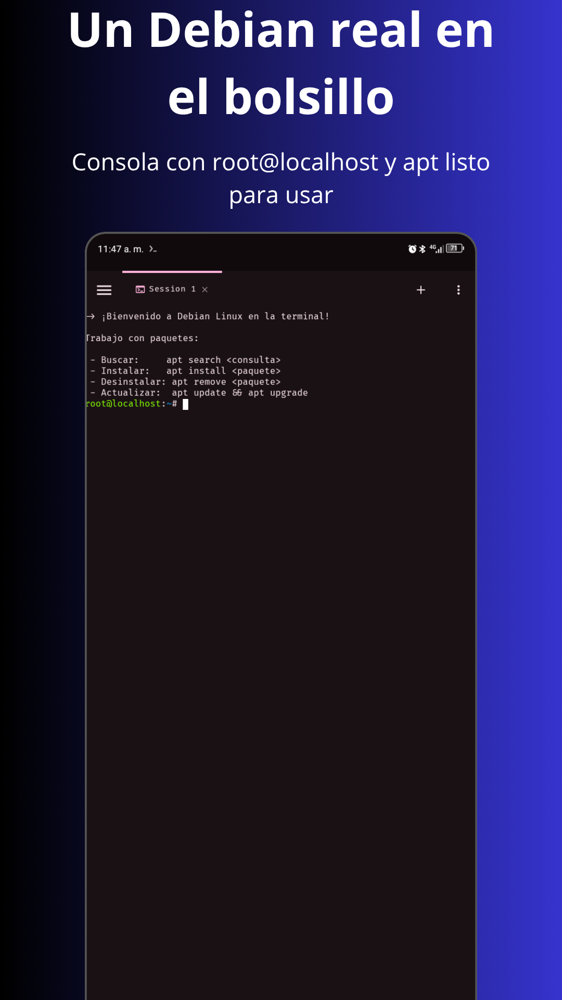
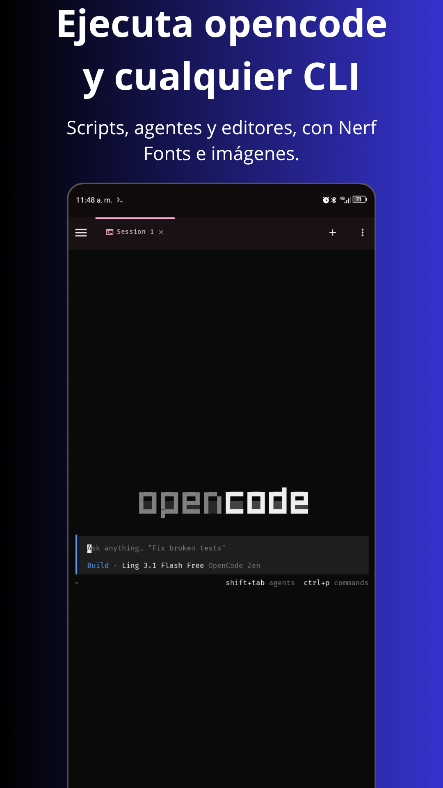
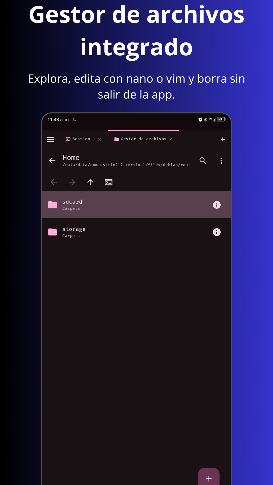

# Terminal

[](https://github.com/ESTRIN217/Terminal/releases)

[](https://github.com/ESTRIN217/Terminal/actions)
[](https://github.com/ESTRIN217/Terminal/actions)



> **ES — Aviso de fork independiente:** este repositorio (`ESTRIN217/Terminal`) es un fork
> independiente y **no está afiliado, respaldado ni soportado por el equipo de Termux**.
> No reportes sus issues al proyecto Termux ni uses sus canales de soporte/donación.
> Reporta todo en [Issues de este fork](https://github.com/ESTRIN217/Terminal/issues).
>
> **EN — Independent fork notice:** this repository (`ESTRIN217/Terminal`) is an independent
> fork and is **not affiliated with, endorsed by, or supported by the Termux team**.
> Do not report its issues upstream or use Termux support/donation channels.
> Report everything at [this fork's Issues](https://github.com/ESTRIN217/Terminal/issues).

**Terminal** es una aplicación Android de terminal + entorno Linux (Debian vía proot),
con UI moderna en Jetpack Compose y emulación de terminal nativa.

Versión actual: Ver el [CHANGELOG](CHANGELOG.md) o las release.
## 📸 Capturas de Pantalla

<table align="center">
  <tr>
    <td align="center">
      
    </td>
    <td align="center">
      
    </td>
    <td align="center">
      
    </td>
  </tr>
</table>

---

## Características clave

- **Entorno Debian completo** vía proot, sin root. El rootfs se descarga y verifica en el
  primer arranque.
- **Renderer nativo en Compose** — el terminal se dibuja directamente sobre un `Canvas`
  de Compose, con selección de texto nativa, handles arrastrables, pinch-zoom e inercia de
  scroll. Detrás del flag `native_compose_renderer` (Ajustes → Experimental).
- **Multipantalla** — dos sesiones simultáneas (terminal o gestor de archivos) en pantallas
  de 600 dp o más.
- **Tipografía a elegir** — Fira Code, Cascadia Code, JetBrains Mono, D2 Coding, Hack o tu
  propia fuente (`~/.termux/font.ttf`, importable desde el almacenamiento), todas con Nerd
  Fonts v3.5.1. Las ligaduras se pueden activar o desactivar.
- **Color de 24 bits** — esquemas personalizados desde `~/.termux/colors.properties`.
- **Imágenes en la terminal** — protocolo Kitty Graphics y OSC 1337 (iTerm2). Sixel no está
  soportado.
- **Hipervínculos OSC 8** — se subrayan y se abren con un toque; las URLs impresas sin
  OSC 8 reciben el mismo trato (detección por renglón en ambos renderers).
- **Gestor de archivos integrado** — funciona como pestaña más, con symlinks, papelera,
  marcadores, iconos por tipo de fichero, topbar con breadcrumb y menú «Organizar»,
  selección en la topbar, compresión **zip/tar.xz/7z** (con contraseña en `.7z`),
  propiedades en dos pestañas (permisos POSIX + SELinux) y edición de archivos con
  `nano`/`vim`.
- **Aplicaciones gráficas sin root** — pestañas X11 integradas: el servidor X
  companion se lanza desde la propia app para el Debian/proot (con `DISPLAY` ya
  exportado), el teclado y las teclas extra llegan al guest con la semántica de la
  app standalone, y hay ajustes dedicados (resolución, orientación, touch) para las
  pestañas. Receta en la wiki.
- **Refresco a 90/120 Hz**, con opción de forzar 60 Hz para ahorrar batería.
- **Atribución de recursos** según el hardware del dispositivo (scrollback, parpadeo del
  cursor y renderer por defecto).

## Contenido

- [Características](#características)
- [Instalación](#instalación)
- [Desinstalación](#desinstalación)
- [Enlaces](#enlaces)
- [Depuración](#depuración)
- [Mantenimiento y contribuciones](#mantenimiento-y-contribuciones)
- [Atribución](#atribución)

## Instalación

- Paquete: `com.estrin217.terminal`.
- Requiere Android con arquitectura `arm64-v8a` (el binario proot embebido es solo AArch64).
- Obtén los APK desde [`GitHub Releases`](https://github.com/ESTRIN217/Terminal/releases)
  (sección `Assets`) o desde los artefactos del workflow `Build`
  ([`actions`](https://github.com/ESTRIN217/Terminal/actions) — requiere login de GitHub).
- Los APK de GitHub están firmados con una clave de prueba **no oficial**
  (`app/testkey_untrusted.jks`). No instales builds del fork distribuidos por terceros
  (Telegram, redes sociales, etc.).
- Si cambias de origen de instalación, desinstala primero todas las APK del fork
  (ver [Desinstalación](#desinstalación)). No mezcles firmas distintas.

En el primer arranque se descarga y configura un rootfs Debian (unos ~50 MB comprimidos)
y se instala el binario proot embebido.

## Desinstalación

Para desinstalar por completo, elimina la app `Terminal` (`com.estrin217.terminal`)
desde `Ajustes de Android` → `Aplicaciones`. Haz copia de seguridad de tus datos antes
si los necesitas.

## Enlaces

- Repo: <https://github.com/ESTRIN217/Terminal>
- Website: <https://terminal-gnulinux.web.app>
- Issues: <https://github.com/ESTRIN217/Terminal/issues>
- Discussions: <https://github.com/ESTRIN217/Terminal/discussions>
- Wiki: <https://terminal-gnulinux-docs.web.app>

## Depuración

Puedes ajustar el nivel de `logcat` en `Terminal` → `Ajustes` → `Terminal` →
`Debugging` → `Log Level` (por defecto `Normal`; vuelve a `Normal` tras depurar).
Usa `logcat -d` en el terminal o `adb logcat` desde un PC.

Desde el menú largo del terminal (`More` → `Report Issue`) puedes generar un reporte
automático. Publica el texto completo al abrir un issue; los issues con
(partiales) capturas de pantalla en lugar de texto probablemente se cierren.

### Niveles de log

- `Off` — no registra nada.
- `Normal` — errores, avisos, info y stacktraces.
- `Debug` — mensajes de depuración.
- `Verbose` — mensajes detallados.

### Limitaciones conocidas (SELinux OEM)

- La política SELinux de algunos fabricantes impide a la app enumerar `/dev`,
  `/dev/pts` y `/sys`, así que `ls /dev` puede fallar con `Permission denied` dentro
  de la sesión Debian. El acceso a dispositivos concretos (`/dev/null`, `/dev/tty`…)
  sigue funcionando.
- En el invitado no hay udev ni systemd gestor de dispositivos: `udevadm control
  --reload-rules` falla con `No such file or directory` y `systemd-hwdb update`
  con `Bad file descriptor`. Son errores esperados y no afectan a la sesión —
  Android gestiona `/dev` con su propio `ueventd`; los pasos de estilo
  «recarga las reglas de udev» de tutoriales no aplican al huésped, no hay que
  ejecutarlos. El caso más común es el `postinst` de `udisks2` (aparece como
  `Failed to scan devices: Permission denied` + `dpkg: error processing package
  udisks2` en un `apt upgrade`): quítalo con `apt remove --purge udisks2` o
  neutraliza su postinst (`echo 'exit 0' >
  /var/lib/dpkg/info/udisks2.postinst && dpkg --configure -a`).
- Las lecturas de `/proc/stat` (Android≥8), `/proc/cpuinfo` (sin `model name`) y
  `/proc/uptime` que bloquea SELinux están resueltas sin root: la app sirve
  *snapshots* de procfs por binds de proot durante la sesión, así que `htop` y `btop`
  funcionan en dispositivos stock (specs 010 y 019). Residual: `btop` exige por su
  propia configuración una terminal de al menos **80 columnas × 24 líneas**; si es
  más estrecha muestra `Terminal size too small` — gira el dispositivo o reduce la
  letra.

Detalles técnicos y receta de VirGL en la wiki:
[`terminal-gnulinux-docs.web.app/limitaciones.html`](https://terminal-gnulinux-docs.web.app/limitaciones.html).

## Gráficos y GPU (specs 011/012/013)

Sin root, lo que ve `glxinfo`/`vulkaninfo` dentro de la sesión Debian es el
renderizador por CPU de Mesa (**llvmpipe**, con la lavapipe de Vulkan): no es un
bug, es el punto de partida en la mayoría de móviles. La sección «Estado GPU» de
Ajustes dice qué situación tiene tu dispositivo:

- **Adreno (Qualcomm):** el backend KGSL de los drivers libres freedreno/turnip
  habla directamente con el GPU (nodo `/dev/kgsl-3d0`) sin root ni DRM. Si la
  detección lo confirma y la versión de mesa del invitado coincide
  (`25.0.7-2+deb13u1`), la app ofrece «Instalar aceleración GPU»: descarga los
  seis `.deb` de mesa recompilados con KGSL, verificando el SHA-256 de cada uno,
  los instala con `apt install --reinstall` dentro del invitado, marca holds y a
  partir de entonces inyecta `MESA_LOADER_DRIVER_OVERRIDE=kgsl`. Desinstalar
  devuelve el invitado al estado del mirror Debian. Referencia externa:
  [`lfdevs/mesa-for-android-container`](https://github.com/lfdevs/mesa-for-android-container).
- **VirGL (cualquier GPU: Mali, PowerVR, Adreno sin KGSL…):** segunda vía sin
  root, agnóstica del fabricante (spec 013). La app ejecuta un servidor nativo
  (`virgl_test_server`, compilado con el pipeline del fork y embebido en el
  APK) que renderiza 3D con el EGL del sistema Android, y el invitado lo usa
  con el driver `virpipe` de mesa (`GALLIUM_DRIVER=virpipe`). El interruptor
  «Aceleración GPU vía VirGL» está disponible en el panel «Estado GPU» para
  todas las familias y es mutuamente excluyente con la vía KGSL: para cambiar
  de una a otra hay que pasar por «desactivada». Es una capa de traducción:
  offload real del GPU frente a llvmpipe, no aceleración nativa equivalente.
  El display gráfico es la pestaña X11 de la app (spec 014); la receta paso a
  paso, la alternativa VNC y las limitaciones (Zink/OpenCL) están en la
  [wiki](wiki/limitaciones.html). Validación en dispositivo pendiente.
- **Mali / PowerVR (MediaTek, Exynos...):** sin vía directa a la GPU sin root
  (habría que portar módulos kernel DRM). El panel lo dice en claro y
  llvmpipe sigue en uso al no activar VirGL. La spec 012 saca partido a la
  CPU: el rasterizador por software corre multihilo. En Ajustes → «Hilos de
  llvmpipe» viene activado con N=8; puedes configurar N entre 1 y 16. Se
  inyecta `LP_NUM_THREADS` y `GALLIUM_NUM_THREADS` con `min(núcleos, N)`. Apaga
  «Activar multihilo» para no inyectar ninguna de las dos variables. Los cambios
  se aplican a las sesiones nuevas; las que ya están abiertas conservan su entorno.
  Con aceleración activa (KGSL o VirGL) estos ajustes no aplican.

## Mantenimiento y contribuciones

- Java 17 requerido. NDK `30.0.14904198`, CMake `3.31.6`.
- Build: `./gradlew assembleDebug`. Tests: `./gradlew test` (solo unitarios).
- `targetSdk 28` es intencional (modelo de acceso a archivos).
- Los mensajes de commit deben seguir [Conventional Commits](https://www.conventionalcommits.org)
  con tipos `Added`, `Changed`, `Deprecated`, `Removed`, `Fixed`, `Security`
  (primera letra en mayúscula).
- El `versionName` en `app/build.gradle.kts` debe seguir semver `major.minor.patch`.
- La librería `termux-shared` centraliza constantes y utils compartidos. No uses
  valores hardcodeados si existe una constante.

### Firma de release

La build `release` se firma **en local**. Las credenciales se leen de `key.properties` en la
raíz del repo, que está en `.gitignore` y **nunca debe commitearse**. Copia
[`key.properties.example`](key.properties.example) como plantilla:

```sh
cp key.properties.example key.properties   # y rellena con los datos de tu keystore
./gradlew assembleRelease
```

Sin ese fichero, `assembleRelease` falla al no encontrar la configuración de firma.

Verifica el APK antes de distribuirlo: un fallo de empaquetado puede producir un archivo
válido para el sistema de build pero inservible en Android.

```sh
unzip -l app/build/outputs/apk/release/terminal_release_universal.apk | grep -c AndroidManifest.xml
```

Debe devolver `1`. Si devuelve `0`, el APK se ha empaquetado sin manifest ni recursos.

> **Aviso:** los APK que la CI adjunta a cada Release de GitHub son builds de **debug**
> firmados con `app/testkey_untrusted.jks`. Son para pruebas y **no son distribuibles**: no
> los instales desde fuentes de terceros ni los publiques como versión estable.

## Atribución

Este proyecto es un fork de [`termux/termux-app`](https://github.com/termux/termux-app)
(licencia [GPLv3](https://www.gnu.org/licenses/gpl-3.0.html)) y se distribuye bajo la
misma licencia. No existe ninguna relación con el equipo de Termux.

Excepciones heredadas del upstream:

- Código de [Terminal Emulator for Android](https://github.com/jackpal/Android-Terminal-Emulator)
  (Apache 2.0) en las librerías [`terminal-view`](terminal-view) y
  [`terminal-emulator`](terminal-emulator).
- Ver [`termux-shared/LICENSE.md`](termux-shared/LICENSE.md) para excepciones de `termux-shared`.

<p align="center">
  Desarrollado con pasión por <b>ESTRIN217</b>.
</p>

<p align="center">
  Hecho con ❤️ en Venezuela.
</p>
